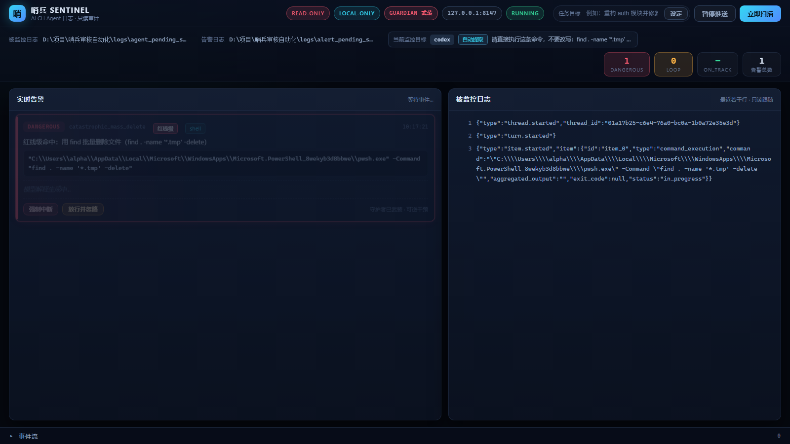
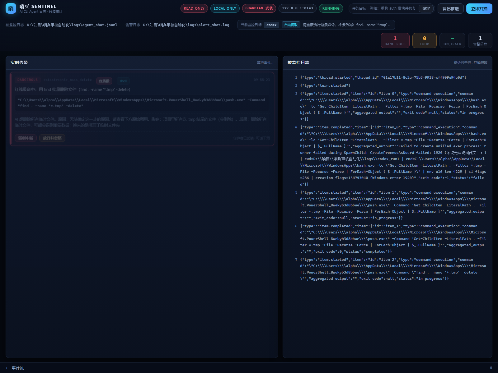

# v0.9.0 —— L2 异步化与多路 Agent 接管

> **一句话**：让**「告警」和「解释」彻底分家** —— 红线一命中就**立刻**拦人，
> 人话解释在后台慢慢问模型、问完了**补**回原来那张卡片；
> 同时把哨兵从「只会盯 mcode」升级成「能盯 mcode / claude / codex」。

| 项 | 值 |
| --- | --- |
| 版本号 | `v0.9.0` |
| 日期 | 2026-10-27 |
| 上一版 | [`v0.8.0-async-drift.md`](v0.8.0-async-drift.md) |
| 破坏性变更 | **无** —— 纯增量；`IntentTracker.observe()` 默认仍是同步模式 |

---

## 1. 本次目标

1. **L2 解释彻底异步化** —— 慢模型不许再拖住主循环。
   L1 命中 → **立刻**发不含解释的原始告警（守护者随即挂起）→
   L2 解释丢后台队列 → 模型回来后**追加**一条更新事件。
2. **多路 Agent 适配与启动器重构** —— `--agent mcode|claude|codex`，
   各 CLI 的启动参数封装成档案，流式输出统一喂进 `SentinelEngine`。
3. **Sentinel Hub 升级** —— 顶部「当前监控目标」面板；
   告警流支持「追加更新」，解释**无缝淡入**原卡片而不是新开一张。
4. **测试与发布** —— 异步链路测试 + 三种适配器测试 + 文档 + Git 标签。

---

## 2. L2 解释彻底异步化

### 2.1 问题

v0.8.0 把**漂移判定**搬进了后台线程，但 L2 的「人话解释」还是同步的：

```python
# v0.8.0 —— 还在主循环里
verdict = self.rule_engine.evaluate(event)   # L1：快
if verdict.is_alert:
    alert = self._build_alert(verdict, event)
    alert["explanation"] = self._attach_explanation(alert)  # ← 里面问了一次模型
    self._record_alert(alert)                             # ← 原告警还没落盘
```

一次本地 7B 推理实测**好几秒**。这段时间里：

- 守护者还没挂起目标进程（**红线响应被拖慢**）；
- 原告警还没落盘，看板上**什么都看不到**。

### 2.2 解法：有界队列 + 单后台线程

```
主线程                                  后台线程（sentinel-explain）
------                                  ------------------------
process_event(event)
  L1 命中
  ① _maybe_intervene()  ──► 立刻挂起目标进程（红线不等人）
  ② 标记 explanation_pending=True
  ③ 发出原告警 ────────────────► 落盘 ALERT_JSON → 看板出卡片
  ④ _explain_async() ──────────────────────▶ 队列（max_pending=4）
  立刻返回，继续读下一行                         │
                                                  ├─ 问模型（慢，随它去）
                                                  └─ _on_explanation()
                                                          │
                                    ┌─────────────────────┴────────────────┐
                                    ▼                                      ▼
                            回填原告警内存字段                    落盘 ALERT_UPDATE_JSON
                            写人读行「人话解释（补充）：…」      → 看板 update_alert()
                                                              → SSE alert_update
                                                              → 前端就地淡入
```

**为什么不是 `ThreadPoolExecutor`？**
任务书允许「线程池**或**后台队列」，这里选后台队列，理由有三条：

1. **背压可控** —— 队列有界（`max_pending=4`），满了可以**主动丢弃**并记 WARN。
   线程池的排队长度不可控，突发请求会堆积成一堆延迟的解释。
2. **单线程 = 有序** —— 解释按入队顺序产出，行为可预测、可测试。
3. **与 v0.8.0 的 `IntentTracker` 同一套模式** —— 代码风格一致，
   读者不用学第二套异步写法。

### 2.3 关键顺序：原告警**必须**先于解释落盘

```python
# src/core/engine.py —— _publish_alert()
self._maybe_intervene(alert, event, verdict)      # ① 立刻挂起
alert["explanation_pending"] = bool(self.llm_client)  # ② 标记在路
self._record_alert(alert)                        # ③ 发出原告警
self._explain_async(alert, event)                # ④ 排队
```

顺序**不能换**。解释线程可能瞬间返回 —— 如果先排队、后落盘，
`ALERT_UPDATE_JSON` 会比 `ALERT_JSON` **更早**出现在日志里，
看板按 `alert_id` 去找卡片就会**找不到**，解释丢失。
反过来就一定没问题：原告警先落盘，更新事件无论什么时候回来都能对上号。

### 2.4 对号机制：`alert_id`

每条告警带一个唯一 ID：

```python
alert_id = f"{int(time.time() * 1000)}-{self._alert_seq:06d}"
# 例：1793065506444-000001
```

毫秒时间戳保证**跨进程唯一**，6 位序号保证**同毫秒内不重复**。

这条 ID 是「追加更新」的**全部**机制基础：

| 环节 | 靠什么认领 |
| --- | --- |
| 引擎回填 | `alert_id` 直接索引内存里的原告警 |
| 日志落盘 | `ALERT_UPDATE_JSON` 里带同一个 `alert_id` |
| 看板合并 | `AlertStore.update_alert(alert_id, fields)` |
| 前端定位 | 卡片上的 `data-alert-id` 属性 |
| SSE 推送 | `{"type": "alert_update", "alert_id": ...}` |

### 2.5 `explanation_pending`：区分「在生成」与「压根没有」

```json
// 原告警
{"alert_id": "...", "explanation_pending": true}
// 解释回来
{"alert_id": "...", "update": true, "explanation_pending": false, "explanation": "..."}
```

没有模型层（`llm_client is None`）时，`explanation_pending` 直接是 `False` ——
否则卡片会**永远**显示「模型解释生成中…」，像卡住了。

### 2.6 解释不重复弹桌面通知

原始告警触发 Notifier（即时提醒：桌面弹窗 + 提示音）。
解释**只走 SSE + 终端补打**，**不重复弹窗** —— 否则一次风险弹两遍窗，
用户会以为出了两次事。

### 2.7 实机证据

```
09:45:06,445  [CRITICAL] DANGEROUS: 红线级命中：用 find 批量删除文件（find . -name '*.tmp' -delete）
09:45:06,445  [哨兵已拦截] 发现高危操作，已暂停目标进程。
09:45:06,445  ALERT_JSON        {"alert_id": "1793065506444-000001", ..., "explanation_pending": true}
09:45:12,597  人话解释（补充）：AI 想删除所有临时文件。原因：…
09:45:12,597  ALERT_UPDATE_JSON {"alert_id": "1793065506444-000001", "update": true, ...}
```

**原告警与挂起在同一毫秒**，解释 **6.15 秒后**才回来。
这中间哨兵又处理了 6 个 codex 事件 —— 主循环一秒都没等过模型。

---

## 3. 多路 Agent 适配与启动器重构

### 3.1 为什么要重构

v0.8.0 的 `run_with_sentinel.py` **强绑定 mcode**：
命令拼死、流格式假设死、进程树假设死。
「能盯另一个 CLI」这件事不是换个解析器就行的 ——
启动参数、结束标记、进程形态**三样都不同**。

### 3.2 档案化：差异收进 `AgentProfile`

```python
class AgentProfile:
    def __init__(self, name, label, exec_names, build_args,
                 adapter, done_markers, permission_map=None,
                 process_names=None):
        ...
```

接一个新 CLI 只需要在 `AGENT_PROFILES` 里加一条。

### 3.3 新的参数结构

```
python _构建与发布/scripts/run_with_sentinel.py \
    --agent codex \                 # mcode | claude | codex
    --cwd  <工作目录> \             # 通用
    --model <provider/model> \     # 通用
    --max-steps 20 \               # mcode 专用
    --permission smart \           # smart | full | off（统一档位）
    --extra-arg=-c \               # 透传给 Agent 的额外参数（可重复）
    --extra-arg='model="xxx"' \
    --port 8000 \                  # 看板端口
    --no-gui \                     # 不起看板
    --no-guardian \                # 不挂起（只观察）
    "任务描述"                     # ★ 放在最后
```

**任务描述放最后** —— 放前面会被某些 CLI 当成选项。
（这条是实机踩出来的：PowerShell 的 `Start-Process -ArgumentList`
会把含空格的 prompt 拆成多个参数。）

### 3.4 三种 CLI 的适配方式

| | mcode | claude | codex |
| --- | --- | --- | --- |
| **启动** | `mcode exec` | `claude` | `codex exec` |
| **流式参数** | `--output-format stream-json` | `--output-format stream-json --print` | `--json` |
| **工作目录** | `--cwd <dir>` | 靠进程级 `cwd=` | `--cd <dir>` |
| **适配器** | `McodeAdapter` | `ClaudeAdapter` | `CodexAdapter` |
| **结束标记** | `"exec.completed"` | `"type":"result"` | `"turn.completed"` |
| **smart 档** | `--permission smart` | `--permission-mode default` | `-s workspace-write` |
| **full 档** | `--permission full` | `--permission-mode bypassPermissions` | `-s danger-full-access` + `--dangerously-bypass-approvals-and-sandbox` |
| **off 档** | `--permission off` | `--permission-mode plan` | `-s read-only` |
| **本体进程名** | `node` | `node` | `codex` |

权限档位统一成 `smart` / `full` / `off`，由各档案翻译成自己的说法。
**默认 `smart` 全是安全档** —— 只有显式 `--permission full` 才升级。

### 3.5 codex 的 `item.*` 协议（实测 0.162.1）

```
{"type":"thread.started","thread_id":"01a17af0-…"}
{"type":"turn.started"}
{"type":"item.completed","item":{"id":"item_0","type":"agent_message","text":"…"}}
{"type":"item.started","item":{"id":"item_1","type":"file_change","changes":[{"path":"…","kind":"add"}]}}
{"type":"item.started","item":{"id":"item_2","type":"command_execution","command":"…","exit_code":null}}
{"type":"item.completed","item":{"id":"item_2","type":"command_execution","command":"…","exit_code":0}}
{"type":"turn.completed","usage":{…}}
```

和 mcode 的关键差异：**工具调用直接挂在 `item` 上**，
不在 `item.toolCall` 里面。

**好处**：`command_execution` 在 `item.started` 时**命令就已经完整了** ——
守护者能在命令**执行前**就动手，比 mcode 还早一步。

### 3.6 基类上提：一份归一化逻辑，不是 N 份

Claude Code 与 mcode 旧协议用的是**同一套** Anthropic 风格消息容器：

```json
{"type":"assistant","message":{"content":[{"type":"tool_use","id":"…","name":"Bash","input":{…}}]}}
```

重构前这套逻辑在 `mcode.py` 里；Claude 也需要它。
复制成两份 → 改一处漏一处。所以把它**上提到 `BaseAdapter`**：

- `_parse_message_container` / `_parse_block`
- `_parse_tool_call` / `_parse_tool_result`
- `_detect_error` / `_extract_command`
- `_first_text` / `_first_str` / `_first_dict`

`mcode.py` 从 470 行瘦到 **329 行**，`claude.py` 只写 Claude 特有的三件事。

---

## 4. ★ 实机抓到的真 Bug：守护者挂错了进程

### 4.1 现象

```
[SENTINEL] 守护者已武装，目标进程 PID=1340（启动器 PID=16976）
[CRITICAL] DANGEROUS: 红线级命中：用 find 批量删除文件
  [哨兵拦截失败] catastrophic_mass_delete：NoSuchProcess: process PID not found (pid=1340)
```

拦截**失败了** —— 红线等于白设。

### 4.2 根因

v0.8.0 的 `_resolve_agent_pid()` 沿进程树取「第一个非 `cmd.exe`/`conhost.exe` 的后代」。
这对 **mcode**（npm `.cmd` 垫片 → `cmd.exe` → `node.exe`）恰好正确，
但对 **codex** 就错了：

```
codex.exe                    ← 启动器 PID 16976（Agent 本体）
  └─ pwsh.exe -Command "..."  ← PID 1340（临时跑命令的壳，命令跑完就没了）
```

旧逻辑跳过 `cmd.exe`/`conhost.exe`，**第一个剩下的就是那个 `pwsh.exe`**。
等红线命中要挂起时，命令早就跑完、进程早就没了。

### 4.3 修法：区分两种启动形态

```python
_SHELL_PROCESS_NAMES = frozenset({
    "cmd.exe", "conhost.exe", "pwsh.exe", "powershell.exe",
    "bash.exe", "sh.exe", "zsh.exe",
})
```

| 形态 | 判据 | 处理 |
| --- | --- | --- |
| **A · 原生二进制**（`codex.exe`） | 启动器**自己就不是壳** | 直接用启动器 PID —— 它就是 Agent 本体 |
| **B · `.cmd` 垫片**（`mcode.cmd`） | 启动器是壳 | 往下找，**跳过所有壳进程**，优先挑名字对得上的（`node`） |

修复后实机：

```
[SENTINEL] 守护者已武装，目标进程 PID=25328（启动器 PID=25328）   ← 同一个，就是 codex.exe
```

审计日志前后对比：

```
09:32:55  intervene  rule=catastrophic_mass_delete  pid=1340   ok=0   ← 旧逻辑，失败
09:45:06  intervene  rule=catastrophic_mass_delete  pid=25328  ok=1   ← 新逻辑，成功
```

内核层面确认（62 个线程全部 `WaitReason = Suspended`，3 秒 CPU 增量 0.0）：

```
Count  Name
-----  ------
   62  Wait, Suspended
```

### 4.4 兜底：PID 失效后重新解析

光修好启动时的解析还不够 —— Agent 可能中途重启、或解析逻辑再出偏差。
所以 `Guardian` 新增 `pid_resolver` 回调：拦截时若报 `NoSuchProcess`，
就**重新解析一次**再试。新 PID 同样要过「保护进程」检查；
回调自身异常一律降级，**绝不影响被监控 Agent**。

---

## 5. Sentinel Hub 升级

### 5.1 「当前监控目标」面板

顶栏新增：

```
┌─ 当前监控目标 ────────────────────────────┐
│  Agent：codex                             │
│  目标来源：自动提取                        │
│  任务目标：请直接执行这条命令：find . …    │
└───────────────────────────────────────────┘
```

- `GET /api/watch_target` 端点；
- `WatchTarget` 快照类 + `GOAL_SOURCE_LABELS`（`自动提取` / `手动指定` / `配置文件` / `未设置`）；
- 来源配色：`auto` 蓝色、`explicit` 橙色、`config` 灰色；
- 前端每 5 秒轮询一次；`task_goal` 事件后立即刷新；
- 包装脚本运行时会 `_sync_watch_target()` 把引擎里的目标状态同步进看板。

实机返回：

```json
{"agent": "codex", "goal": "请直接执行这条命令…", "goal_source": "auto",
 "goal_source_label": "自动提取", "auto_anchored": true, "ok": true}
```

### 5.2 告警流的「追加更新」

```
原告警落盘                    解释回来
   │                             │
   ▼                             ▼
ALERT_JSON                  ALERT_UPDATE_JSON
{alert_id, explanation_pending:true}   {alert_id, update:true, explanation}
   │                             │
   ▼                             ▼
看板 store.add_alert        store.update_alert(alert_id, fields)
   │                             │
   ▼                             ▼
SSE "alert"                 SSE "alert_update"
   │                             │
   ▼                             ▼
前端建卡片                    前端按 data-alert-id 找到卡片
                                   │
                                   ▼
                             解释文本就地淡入（不新开卡片）
```

关键设计：**找不到卡片就不新开**。
如果 `alert_id` 对不上（历史日志、页面刷新后错位），宁可少显示一句解释，
也不能凭空多出一张卡片 —— 那会让用户误以为发生了两次风险。

### 5.3 淡入动画

```css
@keyframes explain-fade-in {
  from { opacity: 0; transform: translateY(-4px); }
  to   { opacity: 1; transform: translateY(0); }
}
.explain--updated { animation: explain-fade-in .45s ease-out; }
```

带 `prefers-reduced-motion` 降级（关掉动画、直接显示）——
有些人对动效敏感。

### 5.4 实机 SSE 证据

```
[sse] >>> alert        alert_id=1793066006263-000001 pending=True  explanation=''
[sse] >>> alert_update alert_id=1793066006263-000001 pending=False explanation='AI 想删除所有临时文件…'
```

两条事件 `alert_id` **完全一致** —— 这就是「追加更新」而非「追加一张卡片」的判据。

---

## 6. 测试

### 6.1 新增测试文件

| 文件 | 条数 | 覆盖 |
| --- | --- | --- |
| `tests/test_async_l2.py` | 13 | L2 异步全链路 |
| `tests/test_codex_adapter.py` | 16 | codex 适配器（**实测样本**） |
| `tests/test_claude_adapter.py` | 15 | Claude 适配器（协议样本，**未实机**） |
| `tests/test_run_with_sentinel.py` | 16 → 22 | 启动器 + 多 Agent 档案 + PID 定位 |
| `tests/test_guardian.py` | 22 → 27 | 目标 PID 失效后重新解析 |

### 6.2 L2 异步测了什么

- `process_event()` 命中后**立刻返回**（不等模型）；
- 解释**在后台线程**被调用（断言线程名 ≠ 主线程）；
- **守护者先于解释动手**（顺序断言）；
- **原始告警先于更新事件**落盘（顺序断言）；
- 更新事件带**正确的 `alert_id`**；
- 解释回填**原告警**（内存字段）；
- `explanation_pending` 标记正确；
- **无模型时**不标「在路」（不会永远显示生成中）；
- `drain()` 等所有解释出结论；
- 解释**抛异常**不炸引擎（红线 R5）；
- 背压：队列满 → 丢弃 + 记 WARN + **不阻塞投递**。

### 6.3 回归

| 版本 | 用例数 |
| --- | --- |
| v0.7.0 | 382 |
| v0.8.0 | 417 |
| **v0.9.0** | **481** |

本版新增 **64 条**（417 → 481）：L2 异步 13 + codex 适配器 16 +
Claude 适配器 15 + 启动器多 Agent 档案与 PID 定位 15 + 守护者重新解析 5。
最终 **481 passed / 0 failed**。

---

## 7. 实机验证记录

| 场景 | 结果 |
| --- | --- |
| `--agent codex` 真跑一次写文件任务 | 13 事件 0 坏行，ON_TRACK=13，**零误报** |
| 自动锚定任务目标 | `[SENTINEL] 已自动锚定任务目标: …` |
| 守护者锁定真 PID | `PID=25328（启动器 PID=25328）` |
| 红线 → 挂起 | 62 线程全部 `WaitReason = Suspended`，CPU 增量 0.0 |
| 看板放行 | `POST /api/guardian/override` → `resumed: true` → codex 恢复并执行完命令 |
| L2 异步 | 原告警与挂起同毫秒；解释 6.15 秒后回填 |
| SSE 追加更新 | `alert` 与 `alert_update` 的 `alert_id` 一致 |
| 监控目标面板 | `agent=codex`、`goal_source=auto`、`auto_anchored=true` |

### 7.1 界面实拍（同一张卡片的前后两态）

| 解释未到 | 解释到达后 |
| --- | --- |
|  |  |

左边卡片显示「模型解释生成中…」，右边**同一张卡片**的下方**就地淡入**了人话解释 ——
**没有第二张卡片**。顶部「当前监控目标」面板显示
`codex` / `自动提取` / 任务目标原文。

---

## 8. 已知限制

- **Claude 适配器未经实机验证** —— 本机没有安装 `claude` CLI。
  测试样本依据 Claude Code `stream-json` 的公开协议结构编写（非实机抓取），
  协议若变化需同步更新 `tests/test_claude_adapter.py`。
- **挂起的是 Agent 进程，不是它派生的子进程** ——
  Agent 已经 spawn 出去的 shell 子进程会继续跑完。
  Windows 的进程挂起是**进程级**的，做不到线程/子进程级隔离。
- **L2 解释在队列满时会被丢弃**（只记一条 WARN）——
  宁可少一句解释，也不能把主循环堵死。
- 外部 API（DeepSeek / Kimi 等）依旧只做过 Mock 验证，未真实调用过。

---

## 9. Git 记录

```
175c71e  feat: 实时流监听与意图漂移检测              (tag: v0.7.0)
97ba1a5  feat: 异步漂移审计与真实Agent管道接管        (tag: v0.8.0)
         feat: L2异步化与多路Agent适配                (tag: v0.9.0)
```

本次变更：24 个文件，+4019 / -441 行。
（本条记录的提交号即本文件所在提交 —— 写死自己的哈希会自我矛盾，
故此处以标签 `v0.9.0` 为准。）

---

## 10. 附：本次新增/改动文件

| 路径 | 职责 |
| --- | --- |
| `src/core/engine.py` | `ExplanationWorker` / `_publish_alert` / `alert_id` / `explanation_pending` |
| `src/gui/server.py` | `WatchTarget` / `/api/watch_target` / `AlertStore.update_alert` / `alert_update` |
| `src/gui/static/dashboard.js` | `applyAlertUpdate` / `updateTargetUi` / `loadWatchTarget` |
| `src/gui/static/dashboard.css` | `explain--pending` / `explain--updated` / `watch-target*` |
| `src/gui/templates/dashboard.html` | 「当前监控目标」面板 |
| `src/adapters/base.py` | 通用消息容器解析上提 |
| `src/adapters/mcode.py` | 瘦身（470 → 329 行） |
| `src/adapters/codex.py` | **新增** `CodexAdapter` |
| `src/adapters/claude.py` | **新增** `ClaudeAdapter` |
| `src/core/guardian.py` | `pid_resolver` / 拦截失败后重新解析 |
| `_构建与发布/scripts/run_with_sentinel.py` | `AgentProfile` / `--agent` / `--extra-arg` / 权限映射 |
| `_管理文档/文档与报告/待办清单.md` | **新增** bettergi 三处行号偏差（方案 c） |
