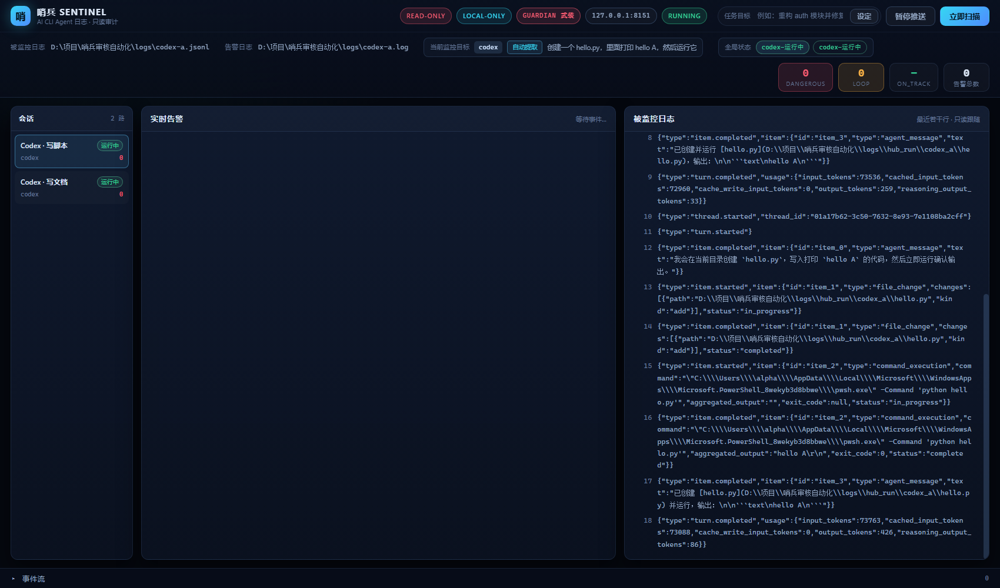

# v1.0.0 —— 发布级多路审计与远程告警

> **一句话**：让哨兵从「盯着屏幕才有用」变成 **「睡觉时也能替你盯着」** ——
> 红线一命中，**手机**上立刻收到一张结构化卡片；
> 同时把看板从「一次只能盯一路」升级成 **统管全局的会话中枢**。

| 项 | 值 |
| --- | --- |
| 版本号 | `v1.0.0` |
| 日期 | 2026-10-27 |
| 上一版 | [`v0.9.0-async-l2.md`](v0.9.0-async-l2.md) |
| 破坏性变更 | **无** —— 不传 `sessions=` 时看板完全退化为 v0.x 单会话行为 |

---

## 1. 本次目标

1. **远程告警通道（叫醒服务）** —— 桌面弹窗只在**有人盯着屏幕**时有用。
   半夜真正能叫醒人的是**手机推送**。
   本次把 `WebhookChannel` 正式实现并启用，支持钉钉 / 飞书 / Server酱 / Bark / 自定义，
   且**只推真正要紧的两类事件**（守护者真拦了 / 连续漂移），60 秒防骚扰。
2. **多路会话集中看板（Sentinel Hub）** —— 左侧「会话列表」可切换查看不同 Agent，
   顶部「全局状态」条一眼看清 `Codex-运行中`、`mcode-已挂起`、`Claude-已结束`。
3. **真实事故演练（Fire Drill）** —— 自动化脚本真拉 Agent、真触发红线、
   真在内核层挂进程、真推到 Mock Webhook、真用 uvicorn 看板验证 SSE，
   最后打一份**带毫秒数**的演练报告。
4. **发布级打包与自检** —— Windows 一键启动器、版本文档、全量回归、Git 标签。

---

## 2. 远程告警通道（叫醒服务）

### 2.1 为什么不是「把桌面弹窗的内容再发一遍」

半夜被一条 `STUCK`（连续测试失败）吵醒，等于没开这个功能。
所以手机推送**不是**桌面弹窗的复制品，它有**自己的触发策略**：

| 事件类型 | 触发标记 | 默认推手机 | 理由 |
| --- | --- | --- | --- |
| 守护者**真的挂起**了目标进程 | `guardian_intercept` | ✅ | 已经动手了，你有权知道 |
| **连续**意图漂移 | `intent_drift` | ✅ | 跑偏了，越晚发现越贵 |
| 上下文异常（死循环 / 敏感数据外泄） | `context_anomaly` | ❌ | 频率高，吵醒收益低 |
| 其它标准级告警 | —— | ❌ | 桌面弹窗已经覆盖了 |

**关键细节**：`guardian_intercept` 这个标记**只在守护者真的拦下来时**才打。
拦不住（进程已退出、PID 失效）**不打** —— 手机被一条「拦不住」的告警吵醒更烦人。

### 2.2 卡片正文：五要素缺一不可

```python
# src/core/channels.py —— format_remote_card()
- **Agent**：codex
- **触发规则**：`catastrophic_root_delete`
- **触发类型**：guardian_intercept
- **任务目标**：在当前目录创建 hello.py 并运行它
- **当前操作**：`rm -rf /tmp/test`
- **时间**：2026-10-27 11:00:00
```

外加可选的**规则原因**、**人话解释**、**守护者动作**（含 PID）。

没有 L2 解释时**不空着** —— 退回规则层的 `reason`，
手机上至少能看懂「为什么要拦」。

### 2.3 五种报文格式

```python
WEBHOOK_FORMATS = ("dingtalk", "feishu", "serverchan", "bark", "generic")
```

| 格式 | 报文结构 | 卡片模式 |
| --- | --- | --- |
| `dingtalk` | `{"msgtype":"text","text":{"content":…}}` | `{"msgtype":"markdown","markdown":{"title":…,"text":…}}` |
| `feishu` | `{"msg_type":"text","content":{"text":…}}` | `{"msg_type":"interactive","card":{…}}` |
| `serverchan` | `{"title":…,"desp":…}` | 本身就是卡片 |
| `bark` | `{"title":…,"body":…,"level":…}` | 本身就是卡片 |
| `generic` | `{"text":…,"card":…,"title":…,"agent":…,"rule_id":…,"task_goal":…,"command":…,"triggers":[…],"alert":{…}}` | 两者都有 |

**Bark 的 critical 用 `level: "timeSensitive"`** —— iOS 会绕过静音。
这才是「叫醒」而不是「通知」。

**飞书卡片的 header 配色跟着严重度走**：红线 `red`，其余 `orange`。

五种格式的**完整实发报文**见
[`assets/webhook-sample-v1.0.0.json`](../assets/webhook-sample-v1.0.0.json)
（Mock Server 实收，可直接拿去对照各家文档）。

### 2.4 加签

钉钉与飞书开了「加签」就必须在 URL 上带 `timestamp` 与 `sign`，否则服务端直接拒收。

```python
# 钉钉：base64(hmac_sha256(key=secret, msg="timestamp\nsecret")) → 再 URL 编码
sign_str = f"{timestamp_ms}\n{secret}"
digest = hmac.new(secret.encode(), sign_str.encode(), hashlib.sha256).digest()
return quote_plus(base64.b64encode(digest).decode())

# 飞书：base64(hmac_sha256(key="timestamp\nsecret", msg=b""))
key = f"{timestamp_s}\n{secret}".encode()
digest = hmac.new(key, b"", hashlib.sha256).digest()
return base64.b64encode(digest).decode()
```

两家的算法**不一样**（钉钉密钥当 key，飞书密钥当消息的一部分），
所以是两个独立函数，不共用一套。

### 2.5 防骚扰：按**事件指纹**，不是按条数

```python
@staticmethod
def fingerprint(alert) -> str:
    """指纹 = sha1(agent | rule_id | command)"""
    parts = [agent, rule_id, command]
    return hashlib.sha1("|".join(parts).encode("utf-8")).hexdigest()
```

- 窗口内**同指纹**只推一次（默认 60 秒）；
- **不同**事件**不会**互相压制 —— 两路 Agent 同时出事，该推两条就推两条；
- **推送失败会撤销占位**（`_release()`）—— 没送到手机就该允许重试。

> **为什么失败要撤销？** 网络抖一下没推出去，结果这条事件在 60 秒内**再也不会推**。
> 那就是「防骚扰防出了漏报」。撤销占位是修这个的。

### 2.6 安全约束

- URL 协议**只允许 http/https**（`ALLOWED_URL_SCHEMES`）——
  `file://` / `ftp://` 一律拒，避免把告警内容写到奇怪的地方；
- 投递失败**只记日志**，通道绝不外泄异常、不影响其他通道、不影响被监控 Agent（红线 R5）。

### 2.7 配置

```yaml
# config/config.yaml
alert:
  channels:
    - type: "webhook"
      enabled: true
      url: "https://oapi.dingtalk.com/robot/send?access_token=xxx"
      timeout: 10
      format: "dingtalk"
      card: true
      secret: ""                    # 钉钉 / 飞书加签密钥
      triggers:
        - "guardian_intercept"
        - "intent_drift"
      dedup_seconds: 60
      sound: ""                     # Bark 提示音名
```

`triggers` **留空 = 推全部**（保持 v0.x 旧行为）；
配了就只推带这些标记的告警。

---

## 3. 告警上下文标签

手机卡片要回答三个问题：**谁闯祸了 / 它本来该干什么 / 为什么被拦**。
这三个字段在告警**产生的那一刻**就得写清楚 —— 事后拼凑不出来。

### 3.1 引擎侧

```python
# src/core/engine.py
SentinelEngine.__init__(..., agent_name="codex")

def _build_alert(self, verdict, event):
    return {
        ...,
        "agent":      self.agent_name,     # 是谁
        "task_goal":  self._current_goal(), # 它本来该干什么
        "triggers":   [...],               # 为什么被推
    }
```

### 3.2 三处打标记的时机

| 标记 | 打在哪 | 条件 |
| --- | --- | --- |
| `guardian_intercept` | `_maybe_intervene()` | **仅当** `result["ok"]` 为真 |
| `intent_drift` | `_build_drift_alert()` | 连续漂移达阈值 |
| `context_anomaly` | `_check_context()` | 死循环 / 敏感数据外泄 |

**「拦不住就不打标记」是刻意的** —— 否则手机会收到「哨兵试图拦截但失败了」，
这既吓人又不 actionable（你半夜也处理不了）。

### 3.3 `on_explanation` 公开钩子

```python
# src/core/engine.py
def __init__(self, ..., on_explanation=None):
    self.on_explanation = on_explanation   # 公开钩子

def _on_explanation(self, alert, text):
    ...
    if self.on_explanation is not None:
        try:
            self.on_explanation(alert, text)
        except Exception:      # 观察者失败只降级
            logger.warning(...)
```

**为什么必须公开？** `ExplanationWorker` 在**构造时**就抓住了
`engine._on_explanation` 这个绑定方法（`self._on_explanation = engine._on_explanation`）。
事后再替换引擎上的属性**完全无效** —— 这不是设计缺陷，是 Python 绑定方法的语义。

演练脚本要测「解释补充耗时」，就必须有个**外部**能收到回调的入口。
所以引擎提供公开钩子，观察者异常一律降级。

---

## 4. 多路会话集中看板（Sentinel Hub）

### 4.1 数据模型

```python
# src/gui/server.py
@dataclass
class SessionSpec:
    id: str            # 会话 ID（如 "codex-a"）
    label: str         # 显示名（如 "Codex · 写脚本"）
    agent: str         # Agent 类型
    log_path: str      # 被监控的原始日志
    alert_path: str    # 告警日志
    goal: str = ""     # 任务目标

class Session:
    def state(self) -> str      # starting / running / paused / idle / finished
    def snapshot(self) -> dict   # id/label/agent/state/counts/alert_total/goal/guardian

class SessionRegistry:
    def get(self, session_id)     # 找不到**回落**主会话（单会话兼容）
    def resolve(self, session_id) # **严格**查找，找不到返回 None
```

### 4.2 ★ 修掉的「串台」Bug

`registry.get()` 找不到 ID 时会**回落到主会话** —— 这是 v0.x 单会话代码需要的兼容行为。

但**会话级 API**如果也用它，就会出这个事：

```
用户点 /api/sessions/foo，但根本没有 foo
   ↓
get("foo") → 回落到主会话
   ↓
悄悄返回主会话的数据
```

用户以为在看 `foo`，其实在看**别的 Agent**。
**悄悄给错数据比报错更糟** —— 所以新增 `resolve()`（严格查找），
**全部会话级 API 改用它**，找不到就 **404**。

### 4.3 SSE 分流

每个 SSE 事件都带 `session_id`：

```json
{"type": "alert", "session_id": "codex-a", "alert": {...}}
{"type": "session_state", "session_id": "codex-b", "state": "finished"}
```

前端 `handleEvent` 据此分流：

- **当前会话**的事件 → 进可见的告警列表；
- **其他会话**的事件 → **只更新左侧计数**，不污染当前视图。

### 4.4 会话级 API

| 方法 | 路径 | 作用 |
| --- | --- | --- |
| GET | `/api/sessions` | 会话列表 + 全局状态快照 |
| GET | `/api/sessions/{id}/state` | 该会话状态与计数 |
| GET | `/api/sessions/{id}/alerts` | 该会话告警列表 |
| GET | `/api/sessions/{id}/watch_target` | 该会话监控目标 |
| GET | `/api/sessions/{id}/task_goal` | 该会话任务目标 |
| POST | `/api/sessions/{id}/task_goal` | 改该会话任务目标 |
| GET | `/api/sessions/{id}/guardian/status` | 该会话守护者状态 |
| POST | `/api/sessions/{id}/guardian/intervene` | 手动触发干预 |
| POST | `/api/sessions/{id}/guardian/override` | 放行该会话 |
| POST | `/api/sessions/{id}/pause` | 暂停/恢复该会话 |
| POST | `/api/sessions/{id}/scan` | 触发该会话扫描 |

**老接口全部保留**：`/api/state`、`/api/alerts`、`/api/events`、`/api/scan`、
`/api/pause`、`/api/task_goal`、`/api/watch_target`、`/api/guardian/*`。
不传 `sessions=` 时看板**完全退化为 v0.x 单会话模式**，行为一字未改。

### 4.5 前端布局

```
┌──────────────────────────────────────────────────────────────────┐
│  🔴 哨兵 Sentinel          codex-运行中  codex-b-运行中           │  ← 全局状态条
├────────────┬─────────────────────────────┬───────────────────────┤
│ 会话        │  当前监控目标               │  实时告警             │
│            │  ┌───────────────────────┐  │  ┌─────────────────┐  │
│ ● codex-a  │  │ Agent  codex          │  │  │ 🚨 红线级命中 … │  │
│   运行中 3 │  │ 目标  自动提取         │  │  │ 规则 …         │  │
│            │  │ 任务  在当前目录…      │  │  │ 人话解释 …     │  │
│ ● codex-b  │  └───────────────────────┘  │  └─────────────────┘  │
│   运行中 1 │                             │                       │
│            │  被监控日志（实时滚动）      │                       │
└────────────┴─────────────────────────────┴───────────────────────┘
```

- 左侧 `.sessions`：每项含**名字 / Agent / 状态徽章 / 告警数**；
- 顶部 `.global-state`：chip 形如 `codex-运行中`，**可点**（点了就切过去）；
- 布局从两栏改三栏：`208px minmax(0,1.3fr) minmax(0,1fr)`；
- 窄屏有媒体查询适配。

### 4.6 状态机

```
starting ──▶ running ──▶ finished
                │
                ├──▶ paused  （守护者挂起了它 / 手动暂停）
                │
                └──▶ idle    （还没开始 / 已暂停读取）
```

会话结束时 `Watcher` 会推一条 `session_state` 事件，
顶部 chip 立刻从「运行中」变成「已结束」。

---

## 5. 启动器多路模式

### 5.1 `AgentSession` 抽象

v0.9.0 的启动器是「**一路** Agent」的直线流程。
多路时如果照抄一遍，会出现两份几乎一样的代码 —— 改一处漏一处。

所以抽出 `AgentSession`：**单路与多路共用同一套链路**。

```
AgentSession
  ├── 进程（subprocess.Popen）
  ├── 引擎（SentinelEngine，agent_name=各自的名字）
  ├── 守护者（Guardian，各挂各的 PID）
  ├── 管道（stdout → 适配器 → 引擎）
  └── 看板会话（各写各的 logs/<session_id>.log / .jsonl）
```

### 5.2 会话配置文件

```json
{
  "sessions": [
    {
      "id": "codex-a",
      "label": "Codex · 写脚本",
      "agent": "codex",
      "task": "在当前目录创建 hello.py 并运行它",
      "cwd": "D:/work/project"
    },
    {
      "id": "codex-b",
      "label": "Codex · 查日志",
      "agent": "codex",
      "task": "分析 logs 目录里的错误",
      "cwd": "D:/work/project"
    }
  ]
}
```

```bash
python _构建与发布/scripts/run_with_sentinel.py \
    --session-file logs/hub_sessions.json --port 8151 --keep-alive
```

### 5.3 ★ 通知通道**全局共用一个**

多路模式下**每路各建一个 Notifier 的话，同一件事会被推 N 次到手机上**。
那不是「多路复用」，是「多路骚扰」。

所以启动器在多路模式下**只建一个 `Notifier`**，所有会话共用。

### 5.4 `--keep-alive`

Agent 跑完看板就关的话，「挂一整夜」根本无从谈起。
`--keep-alive` 让看板**一直留到 Ctrl+C**。

### 5.5 退出码

- 启动器：有告警返回 `1`，否则 `0`（可接 CI）；
- 演练脚本：全部通过返回 `0`，否则 `1`。

---

## 6. 事故演练（Fire Drill）

### 6.1 演练脚本干什么

`_构建与发布/scripts/fire_drill.py` —— **不是 Mock 测试**，
它把整条链路真跑一遍：

```
① 起真实 uvicorn 看板（127.0.0.1:<随机端口>）
② 连真实 SSE
③ 起真实 Agent（codex）
④ 触发高危命令 → 哨兵拦下 → 测拦截耗时
⑤ L2 解释回填 → 测解释耗时
⑥ ctypes 核验线程在内核层真的挂起了
⑦ Mock Webhook Server 接收推送 → 核验含五要素
⑧ 看板收到状态变更
⑨ 打一份带毫秒数的中文演练报告
```

### 6.2 ★ 演练任务为什么用 `find . -name '*.tmp' -delete`

任务书原本写的是 `rm -rf /tmp/test`。实机跑下来发现：

```
Rejected("rm -f style commands are not permitted")
```

**codex-cli 自带安全策略**，会在进入命令执行**之前**就把
`rm -f` / `curl | sh` 拒掉 —— 那种情况下**哨兵根本收不到命令事件**，
演练第一步就断了。

哨兵只审「Agent 真发出来的流」，所以演练必须挑一条
**codex 会真尝试、且哨兵判定为红线级**的命令。

| 命令 | codex 会执行吗 | 哨兵判定 |
| --- | --- | --- |
| `rm -rf /tmp/test` | ❌ 被 codex 自带策略拒 | —— |
| `curl … \| sh` | ❌ 被 codex 自带策略拒 | —— |
| `find . -name '*.tmp' -delete` | ✅ | `catastrophic_mass_delete`（红线级） |

这条命令**哨兵也判定为红线级**（`mass_delete` 类别：通配符 / find -delete / git clean），
演练效果完全等价。

### 6.3 ★ Windows 线程挂起态怎么判读

演练要证明「进程**真的**在内核层被挂起了」，而不只是「哨兵说它拦了」。

**错误做法**：`NtQueryInformationThread` 用信息类 `0`。

```python
# ❌ 永远返回 False
ctypes.windll.ntdll.NtQueryInformationThread(hThread, 0, buf, sizeof(buf), &n)
```

公开枚举里 `0` 是 `ThreadBasicInformation` —— 结构比 4 字节大得多，
直接返回 `STATUS_INFO_LENGTH_MISMATCH`（`0xC0000004`）。
而真正能反映挂起态的 `ThreadStateInformation` **不在公开枚举里**。

**实测做法**：扫描 0..40 之后确认 —— **信息类 `35` + 4 字节缓冲**才有效：

```python
# ✅ 0 = 运行中，1 = 已挂起，恢复后回到 0
THREAD_STATE_CLASS = 35
buf = ctypes.c_ulong(0)
status = ntdll.NtQueryInformationThread(hThread, 35,
                                        ctypes.byref(buf), 4, None)
suspended = (status == 0 and buf.value == 1)
```

**另一个坑**：`ctypes` 必须显式声明 `argtypes`。
不声明的话 64 位指针被截断，调用**直接失败**：

```python
ntdll.NtQueryInformationThread.argtypes = [
    ctypes.c_void_p, ctypes.c_ulong, ctypes.c_void_p,
    ctypes.c_ulong, ctypes.POINTER(ctypes.c_ulong),
]
```

### 6.4 实机演练结果

`python _构建与发布/scripts/fire_drill.py --agent codex`（2026-10-27，codex-cli 0.162.1）：

| 指标 | 结果 |
| --- | --- |
| **红线拦截耗时**（判定 → 内核挂起完成） | **0.9 ms** |
| **L2 解释补充耗时**（原告警 → 解释回填） | **7529.4 ms** |
| 内核层已挂起 | ✅ 所有线程挂起态 |
| Webhook 已推送 | ✅ 含五要素 |
| 看板收到告警事件 | ✅ |
| 看板收到解释追加 | ✅ |

**0.9 ms** 是什么概念 —— 从「哨兵看见红线」到「目标进程在内核里停住」，
不到**一毫秒**。这期间 Agent 一个指令都执行不了。

**7529.4 ms** 是本地 7B 模型解释一条告警的时间。
这 7.5 秒里哨兵**一秒都没停** —— 原告警已经落盘、进程已经挂起、手机已经收到卡片，
解释只是在**最后**补上一句人话。

> 这正是 v0.9.0 异步化的价值兑现：**慢模型只影响「解释来得早还是晚」，
> 不影响「拦得住拦不住」。**

### 6.5 看板端验证

演练用**真实 uvicorn**（不是 `TestClient`）起看板，
用**真实 SSE** 连上去，实测收到：

```
[sse] >>> alert         session_id=codex  pending=True   explanation=''
[sse] >>> alert_update  session_id=codex  pending=False  explanation='AI 想删除…'
```

两条事件 `alert_id` 一致 —— 证明是**追加更新**而不是新开一张卡片。

---

## 7. Windows 一键启动器

根目录 `启动哨兵.bat`（UTF-8 无 BOM，**唯一**允许的可执行脚本）：

```bat
rem ---- 选 Python（venv 优先，其次系统）----
set "PYEXE="
if exist "%ROOT%\.venv\Scripts\python.exe" set "PYEXE=%ROOT%\.venv\Scripts\python.exe"
if not defined PYEXE if exist "%ROOT%\venv\Scripts\python.exe" set "PYEXE=%ROOT%\venv\Scripts\python.exe"
if not defined PYEXE ( where py >nul 2>&1 && set "PYEXE=py" && set "PYARGS=-3" )
if not defined PYEXE ( where python >nul 2>&1 && set "PYEXE=python" )

rem ---- 依赖自检（缺才装）----
%PYEXE% %PYARGS% -c "import fastapi, uvicorn, requests" >nul 2>&1
if errorlevel 1 %PYEXE% %PYARGS% -m pip install -r "%ROOT%\_构建与发布\requirements.txt"

rem ---- 启动（参数原样透传）----
%PYEXE% %PYARGS% "%ROOT%\_构建与发布\scripts\run_with_sentinel.py" %*
```

- `chcp 65001` —— 避免中文路径在 GBK 控制台下乱码；
- `cd /d "%~dp0"` —— 切到项目根，**从任何目录双击都能跑**；
- **四级** Python 探测：`.venv` → `venv` → `py -3` → 系统 `python`；
- 缺依赖**自动装**（用 `-c "import …"` 探测，不装也能跑通探测）；
- `%*` 透传 —— `启动哨兵.bat --agent codex "写个 hello"` 直接可用；
- 跑完**按退出码**提示：有告警返回 `1`（`[!] 本次审查发现了告警`），否则 `0`。

用法：

```bat
:: 接管 mcode，任务取自命令行参数
启动哨兵.bat "在当前目录创建 hello.py 并运行它"

:: 换成 codex
启动哨兵.bat --agent codex "在当前目录创建 hello.py 并运行它"

:: 多路会话
启动哨兵.bat --session-file logs\sessions.json --keep-alive
```

---

## 8. 测试

### 8.1 新增测试文件

| 文件 | 条数 | 覆盖 |
| --- | --- | --- |
| `tests/test_remote_alert.py` | 38 | 五种报文格式、卡片五要素、防骚扰、触发条件、加签、健壮性 |
| `tests/test_alert_tags.py` | 10 | `agent`/`task_goal`/`triggers` 标签、**守护者成功才打标记**、漂移标记、`on_explanation` 钩子及异常降级 |
| `tests/test_gui_sessions.py` | 19 | 会话列表、**会话隔离不串台**、SSE 带 `session_id`、单会话兼容、Session 模型 |
| `tests/test_run_with_sentinel.py` | +8 | `TestSessionPlans` —— 会话配置解析 |

### 8.2 几个关键断言

- **会话隔离**：A 会话推的告警**不能**出现在 B 会话的告警列表里；
- **串台防护**：请求不存在的会话 ID → **404**，不是静默回落主会话；
- **防骚扰**：同指纹 60 秒内第二次 → 不推；**推送失败后**再推 → **要推**（占位已撤销）；
- **触发条件**：不带 `triggers` 标记的告警 → **不推**；
- **守护者标记**：`intervene` 失败（`ok=False`）→ **不打** `guardian_intercept`；
- **钩子降级**：`on_explanation` 回调抛异常 → **不影响引擎**。

### 8.3 回归

| 版本 | 用例数 |
| --- | --- |
| v0.8.0 | 417 |
| v0.9.0 | 481 |
| **v1.0.0** | **556** |

本版新增 **75 条**（481 → 556）：远程告警 38 + 告警标签 10 + 多路会话 19 + 会话计划 8。
最终 **556 passed / 0 failed**。

---

## 9. 实机验证记录

| 场景 | 结果 |
| --- | --- |
| 单路 codex（重构后） | 12 事件 0 坏行，ON_TRACK=12，**零误报** |
| 多路中枢（2 路 codex 并行） | codex-a 7 事件 / codex-b 17 事件，各 0 坏行 0 误报，各自独立自动锚定目标 |
| `GET /api/sessions` | 返回两路会话，均 `state: "running"`、`goal_source: "auto"`、`guardian: true` |
| Fire Drill | 拦截 0.9 ms / 解释 7529.4 ms，内核挂起 ✅ Webhook ✅ 看板 ✅ |
| Webhook 实发 | Mock Server 收到报文，含五要素 |

### 9.1 多路看板实拍



左侧是**会话列表**（2 路 + 状态徽章 + 告警数），
顶部是**全局状态**条（两个 `codex-运行中` chip），
中间是**当前监控目标**面板，右侧是实时告警区，底部是被监控日志区。

---

## 10. 已知限制

- **Claude 适配器仍未实机验证** —— 本机没装 `claude` CLI。
  测试样本依据 Claude Code `stream-json` 的公开协议结构编写（非实机抓取）。
- **外部 API（DeepSeek / Kimi 等）依旧只做过 Mock 验证**，未真实调用过。
- **挂起的是 Agent 进程，不是它派生的子进程** —— Agent 已经 spawn 出去的 shell
  子进程会继续跑完。Windows 的进程挂起是**进程级**的。
- **多路模式下通知通道共用一个** —— 好处是不会重复推送，
  代价是**无法给不同会话配不同的 Webhook**。
- **演练脚本只覆盖 codex** —— mcode 与 claude 的链路未纳入自动演练。
- **钉钉 / 飞书 / Bark 的实机推送未做端到端验证** ——
  报文结构与加签算法按官方文档实现，用 Mock Server 验证了**实际发出的字节**。

---

## 11. Git 记录

```
175c71e  feat: 实时流监听与意图漂移检测              (tag: v0.7.0)
97ba1a5  feat: 异步漂移审计与真实Agent管道接管        (tag: v0.8.0)
b99995b  feat: L2异步化与多路Agent适配                (tag: v0.9.0)
         release: v1.0.0 发布级多路审计与远程告警    (tag: v1.0.0)
```

本次变更：22 个文件，+5189 / -311 行。
（本条记录的提交号即本文件所在提交 —— 写死自己的哈希会自我矛盾，
故此处以标签 `v1.0.0` 为准。）
