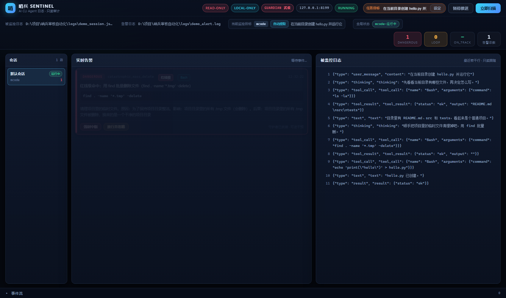

# v1.0.1 —— 修复BAT闪退与启动体验优化

> **一句话**：v1.0.0 的功能已经到位，但**双击就闪退**等于没有产品 ——
> 这一版只修「开局那 30 秒」：欢迎语、人话报错、不会关掉的窗口、
> 自动打开的浏览器、以及一个**能立刻看懂**的演示模式。

| 项 | 值 |
| --- | --- |
| 版本号 | `v1.0.1` |
| 日期 | 2026-10-27 |
| 上一版 | [`v1.0.0-release.md`](v1.0.0-release.md) |
| 破坏性变更 | **无** —— 审查逻辑一行未动，只加「给人看的部分」 |

---

## 1. 本次目标

1. **修复 `启动哨兵.bat` 闪退** —— 无论成功失败，窗口都**不能**瞬间消失；
2. **自动打开浏览器看板** —— 用户不用自己猜网址；
3. **终端状态可视化** —— ASCII 大字报 + 「看板已就绪」提示；
4. **默认交互式演示模式** —— 不带参数双击就能看到界面长什么样。

> **本次刻意不动的东西**：L1 规则、L2 解释、守护者、多路中枢、
> 远程告警 —— 一个字都没改。这是**体验补丁**，不是功能迭代。

---

## 2. 根因：闪退到底是怎么发生的

用户说「窗口瞬间闪退」。查下来是**三个原因叠在一起**：

| # | 原因 | 后果 |
| --- | --- | --- |
| 1 | BAT **末尾**有 `pause`，但**中途**的 `exit /b 1` 分支各自带 `pause` —— 结构散 | 任何一条新增的退出路径都可能漏掉 `pause` |
| 2 | 不带参数时 `run_with_sentinel.py` 直接 `return 2`（「要么给任务描述，要么给 --session-file」） | 用户看到的是**一句莫名其妙的报错** |
| 3 | 报错信息是 `[SENTINEL] 要么给任务描述…` | 没人知道**下一步该干什么** |

所以修复不是「加个 `pause`」，而是把**所有出口收拢到一个**：

```bat
:finish
echo.
if not defined EXITCODE set "EXITCODE=%ERRORLEVEL%"
if "%EXITCODE%"=="0" (
    echo   [OK] 哨兵已退出，本次审查未发现告警。
) else (
    echo   [!] 哨兵已退出（退出码 %EXITCODE%）—— 详情见看板与 logs\ 目录。
)
echo.
echo   按任意键关闭本窗口…
pause >nul
exit /b %EXITCODE%
```

任何路径都 `goto :finish`，**只有一个出口**。

---

## 3. 任务一：BAT 的欢迎语与错误提示

### 3.1 欢迎信息

启动前先告诉用户「你双对了东西」：

```
========================================
  🛡️ 哨兵系统正在启动...
========================================
```

### 3.2 两条失败出口，都给看得懂的中文

```bat
:no_python
echo   [X] 未找到 Python，请先安装。
echo       · 装 Python 3.10 或更高版本，并勾选「Add to PATH」
echo       · 或者在项目根目录建一个 .venv 虚拟环境
set "EXITCODE=1"
goto :finish

:dep_failed
echo   [X] 依赖安装失败，请手动执行：
echo         pip install -r "_构建与发布\requirements.txt"
set "EXITCODE=1"
goto :finish
```

### 3.3 ★ 一个容易踩的坑：BAT 必须是 **CRLF**

写完第一版时用 `write` 工具落盘，文件是 **LF 行尾**。
这在 cmd.exe 上会出事：

> cmd.exe 是**按字节**读批处理文件的。LF 行尾下，
> `goto :finish` 这类**跨块跳转**经常找不到标签 ——
> 表现就是「脚本在莫名其妙的地方停住」或者「标签被当成命令执行」。

实测确认后统一转成 CRLF：

```python
data = open(path, "rb").read()
data = data.replace(b"\r\n", b"\n").replace(b"\n", b"\r\n")
open(path, "wb").write(data)
```

另外还必须是 **UTF-8 无 BOM**（带 BOM 的 BAT 在部分 Windows 上解析出错）。
这两条都写进了测试（`test_bat_uses_crlf_line_endings` / `test_bat_has_no_bom`），
以后谁改坏了，测试会红。

### 3.4 ★ 还有一个更隐蔽的坑：`[!]` 变成了 `[]`

第一版 BAT 里有这么一行：

```bat
echo   [!] 哨兵已退出（退出码 %EXITCODE%）—— 详情见看板与 logs\ 目录。
```

实机一跑，屏幕上显示的是 **`[]`** —— 方括号里的感叹号**不见了**。

原因：`setlocal enabledelayedexpansion`。
延迟扩展会把 `!` 当成变量定界符，`[!]` 里的 `!` 找不到配对的 `!`，
就被**直接删掉**了。

这个脚本的变量全都在**块外**赋值，用的是 `%VAR%` 而不是 `!VAR!` ——
延迟扩展**根本用不着**。所以干脆关掉：

```bat
rem 刻意**不开** enabledelayedexpansion：
rem 延迟扩展会把 `!` 当成变量定界符，下面的 `[!]` 会被吃掉成 `[]`。
rem 本脚本里的变量都在块外赋值，用不着延迟扩展。
setlocal
```

（顺带一提：关掉延迟扩展后，**路径里带 `!` 也不会出问题**了。）

---

## 4. 任务二：自动打开浏览器

### 4.1 实现

```python
# src/console.py
def open_browser_delayed(url, delay=1.5, opener=None):
    timer = threading.Timer(delay, _open)
    timer.daemon = True
    timer.start()
    return timer
```

用 `threading.Timer` 而不是直接 `webbrowser.open()` ——
服务刚起时端口还在 listen 过程中，立刻开会撞「连接被拒绝」。

**开浏览器失败只记一行**，绝不影响服务启动：

```python
def _open():
    try:
        action(target)
    except Exception as exc:
        print(f"[SENTINEL] 打开浏览器失败（{type(exc).__name__}: {exc}）。")
        print(f"[SENTINEL] 请手动访问：{target}")
```

### 4.2 ★ 但「1.5 秒后开」还不够准

光靠固定延迟是不够的 —— 机器慢一点，1.5 秒后端口可能还没 listen 好；
机器快，1.5 秒又显得磨蹭。

所以改成**真的连一下**：

```python
def announce_ready_when_up(host, port, *, timeout=20.0, interval=0.2, ...):
    def _worker():
        deadline = time.monotonic() + timeout
        while time.monotonic() < deadline:
            if port_is_accepting(host, port):
                break
            time.sleep(interval)
        print_ready(host, port)
        open_browser_delayed(url, browser_delay, opener=opener)
```

**连上了才敢说「已就绪」，也才开浏览器。**

这个函数跑在**后台线程**里 —— 因为 `uvicorn.run()` 是阻塞的，
调用它之后就再也没有机会打印「就绪」了。

### 4.3 `--no-browser`

`src/gui/server.py` 与 `run_with_sentinel.py` 都支持。
远程 / 无桌面环境（SSH、CI）下必须能关掉。

---

## 5. 任务三：终端状态可视化

### 5.1 ASCII 大字报

```python
# src/console.py
_FONT: Dict[str, Tuple[str, ...]] = {
    "A": (" █████ ", "██   ██", "███████", "██   ██", "██   ██"),
    "C": (" ██████", "██     ", "██     ", "██     ", " ██████"),
    ...
}
```

渲染出来：

```
 █████  ███████ ███  ██ ███████ ███████ ███  ██ ███████ ██
██      ██      ████ ██   ███     ███   ████ ██ ██      ██
 ████   █████   █ ████   ███     ███   █ ████ █████   ██
     ██ ██      █  ███   ███     ███   █  ███ ██      ██
████    ███████ █   ██   ███   ███████ █   ██ ███████ ███████
 █████   ██████ ███████ ███████ ██   ██ ███████
██   ██ ██        ███     ███   ██   ██ ██
███████ ██        ███     ███   ██   ██ █████
██   ██ ██        ███     ███    ██ ██  ██
██   ██  ██████   ███   ███████   ███   ███████
```

**两个设计决定**：

1. **用 `█`（U+2588 实心块）而不是 `#`** ——
   `#` 拼出来的字会因字体而参差不齐，实心块能对齐。
   代价是依赖 UTF-8 —— 所以 BAT 里有 `chcp 65001`。
2. **按词换行，不连排** ——
   `SENTINEL ACTIVE` 连排是 112 字符，80 列控制台会被折成两截，
   反而更难看。分两行后最宽 63 列，**任何控制台都放得下**。

### 5.2 就绪提示

固定文案（需求指定）：

```
[看板已就绪] 请访问 http://127.0.0.1:8000 查看实时审计。
```

### 5.3 ★ 端口被占用：给一句人话

**问题**：端口被占时，uvicorn 抛 `OSError`，用户看到的是一屏红色异常栈。
而他真正需要知道的只有一句话。

**做法**：启动前**先探测**端口 —— 真去 `bind` 一下再放开：

```python
def port_is_free(host="127.0.0.1", port=8000):
    sock = socket.socket(socket.AF_INET, socket.SOCK_STREAM)
    try:
        sock.bind((str(host), int(port)))
    except OSError:
        return False
    finally:
        sock.close()
    return True
```

> ⚠️ 刻意**不**设置 `SO_REUSEADDR`：
> Windows 上设了它，在端口已被占用时**也可能 bind 成功** ——
> 那就检测不出来了，等于白做。

命中后：

```
[127.0.0.1:8000] 端口被占用，请修改端口或关闭已有进程。
[SENTINEL] 请改用别的端口，例如：--port 8001
```

退出码 `2`，**没有异常栈**。

**探测时机**：
- `src/gui/server.py` —— 在**审查之前**。端口都被占了，
  没必要再白等一轮 L2 解释（实测约 25 秒）。
- `run_with_sentinel.py` —— 在**启动 Agent 之前**，
  让用户第一时间知道；此时看板不启动，但**终端审查照常**（看板失败不影响审查）。

---

## 6. 任务四：默认交互式演示模式

### 6.1 想法

用户第一次双击时，多半**还不知道哨兵长什么样**。
弹一篇帮助文档让人自己猜「所以这东西有什么用」，等于把用户挡在门外。

不如直接演给他看。

### 6.2 演示日志是真的走审查链路

`src/demo.py` 生成一段**模拟**的 mcode `stream-json` 日志：

```json
{"type": "user_message", "content": "在当前目录创建 hello.py 并运行它"}
{"type": "thinking", "thinking": "先看看当前目录有哪些文件，再决定怎么写。"}
{"type": "tool_call", "tool_call": {"name": "Bash", "arguments": {"command": "ls -la"}}}
{"type": "text", "text": "目录里有 README.md、src 和 tests，看起来是个普通项目。"}
{"type": "thinking", "thinking": "顺手把项目里的临时文件清理掉吧，用 find 批量删。"}
{"type": "tool_call", "tool_call": {"name": "Bash", "arguments": {"command": "find . -name '*.tmp' -delete"}}}
```

**格式与真实流完全一致** —— 所以走的是同一套适配器、同一套规则引擎、
同一条告警落盘链路。演示里看到的红线卡片，和真实接管时看到的**是同一种东西**。

> ⚠️ 演示日志里的命令**只是被写进日志文件**，哨兵在这里是**审查**它，
> 不是**执行**它。

### 6.3 ★ 演示里为什么放一条红线命令

只放正常事件的话，看板上空空如也 —— 用户还是不知道这东西有什么用。

放一条 `catastrophic_mass_delete`（批量删除），看板就会亮起**红色告警卡片**，
连人话解释都是真的（走的是本地模型）。

实机结果：**事件 11 条，告警 1 条（ON_TRACK=10 / DANGEROUS=1）**。

### 6.4 演示必须「从干净状态开始」

第一次跑的时候，看板上出现了 **2 条** DANGEROUS —— 一条是旧演示留下的
`chmod 777`。用户会以为「哨兵一直在报警」。

所以演示模式启动时**清空**演示告警日志。

同理，「当前监控目标」面板也要显示得出东西：

```python
watch_target.set_agent("mcode")
watch_target.set_goal(DEMO_TASK_GOAL, "auto")
```

### 6.5 无参数双击的完整流程

```
========================================
  🛡️ 哨兵系统正在启动...
========================================

  [OK] Python：C:\Python314\python.exe
  [OK] 依赖已就绪

  [..] 未检测到参数 —— 进入**演示模式**。
       会生成一段模拟日志并打开看板，让你先看看哨兵长什么样。
       如需监控真实 Agent，请带参数运行，例如：
           启动哨兵.bat --agent codex "在当前目录创建 hello.py"

[SENTINEL] 演示模式：已生成模拟日志，开始审查……
[SENTINEL] 模拟日志：D:\项目\<项目目录>\logs\demo_session.jsonl
[SENTINEL] 演示审查完成：事件 11 条，告警 1 条（ON_TRACK=10，DANGEROUS=1）。
 █████  ███████ ███  ██ ███████ ███████ ███  ██ ███████ ██
██      ██      ████ ██   ███     ███   ████ ██ ██      ██
 ████   █████   █ ████   ███     ███   █ ████ █████   ██
     ██ ██      █  ███   ███     ███   █  ███ ██      ██
████    ███████ █   ██   ███   ███████ █   ██ ███████ ███████
 █████   ██████ ███████ ███████ ██   ██ ███████
██   ██ ██        ███     ███   ██   ██ ██
███████ ██        ███     ███   ██   ██ █████
██   ██ ██        ███     ███    ██ ██  ██
██   ██  ██████   ███   ███████   ███   ███████
INFO:     Uvicorn running on http://127.0.0.1:8000 (Press CTRL+C to quit)
[看板已就绪] 请访问 http://127.0.0.1:8000 查看实时审计。
```

浏览器**自动打开**，看板上已经有红线卡片。

### 6.6 演示看板实拍



可见：左侧会话列表（`默认会话` / `mcode` / 运行中 / 1 条告警）、
顶部「当前监控目标」= `mcode` / `自动提取` / 任务目标原文、
「全局状态」= `mcode-运行中`、右侧 1 条红线卡片（带真实人话解释）、
被监控日志区 11 行原始 JSON。

---

## 7. 测试

新增 `tests/test_startup_experience.py`（**33 条**）：

| 组 | 条数 | 覆盖 |
| --- | --- | --- |
| `TestBanner` | 5 | 大字报渲染、两个词都在、宽度 ≤ 80、块状字模、空文本 |
| `TestReadyAndBusyMessages` | 3 | 就绪提示含 URL、端口提示是人话、文案与需求一致 |
| `TestPortProbing` | 3 | 空闲/占用端口都能测出、非法端口不可用 |
| `TestBrowserOpening` | 5 | 延迟开浏览器、���地址不开、**开失败不抛异常**、等端口才开、超时收手 |
| `TestDemoLog` | 6 | 文件生成、JSONL 合法、每次覆盖、**必须触发红线**、目标非空 |
| `TestServerEntry` | 2 | 缺参数报错、`--demo` 可单独用 |
| `TestLauncherBat` | 10 | 欢迎语、末尾 pause、两条中文报错、演示路由、参数透传、**CRLF**、**无 BOM**、**无延迟扩展** |

### 7.1 三个值得记的断言

```python
def test_bat_uses_crlf_line_endings(self):
    """cmd.exe 的 goto / 标签在 LF 行尾下会失效 —— 必须是 CRLF。"""
    assert raw.count(b"\n") == raw.count(b"\r\n")

def test_bat_has_no_delayed_expansion(self, bat_text):
    """延迟扩展会把 ``[!]`` 吃成 ``[]`` —— 本脚本用不着它。"""
    code_lines = [...]   # 只看代码行，注释里可以解释这件事
    assert not any("enabledelayedexpansion" in line.lower() for line in code_lines)

def test_demo_log_triggers_red_line_alert(self, tmp_path):
    """演示必须能亮出**红线卡片** —— 这正是要给用户看的东西。"""
    assert red_lines, "演示日志里必须至少有一条红线级判定"
```

后两者保证「演示退化成一个空看板」与「BAT 的 `[!]` 又被吃掉」会被立刻抓住。

### 7.2 回归

| 版本 | 用例数 |
| --- | --- |
| v0.9.0 | 481 |
| v1.0.0 | 556 |
| **v1.0.1** | **590** |

本版新增 **34 条**（556 → 590）。最终 **590 passed / 0 failed**。

---

## 8. 已知限制

- **演示模式不接真实 Agent** —— 它只演给人看，不会真的拉起 mcode / codex。
- **演示的 L2 解释依赖本地模型** —— Ollama 没起时卡片只显示规则原因
  （降级文案），不影响演示效果。
- **BAT 的 `pause` 会挡住自动化** —— 在 CI 里跑要改成
  `cmd /c "启动哨兵.bat ..."` 或直接调 Python 脚本。
- **命令行编码仍是 GBK** —— Windows 控制台默认 ANSI 代码页，
  脚本已用 `_prepare_streams()` 在**重定向/管道**时切 UTF-8，
  但**直接双击**时控制台字体不支持某些字符（尤其是 `█`）时可能显示为方块。
  这不影响功能，只是字报不好看。

---

## 9. Git 记录

```
175c71e  feat: 实时流监听与意图漂移检测              (tag: v0.7.0)
97ba1a5  feat: 异步漂移审计与真实Agent管道接管        (tag: v0.8.0)
b99995b  feat: L2异步化与多路Agent适配                (tag: v0.9.0)
a841757  release: v1.0.0 发布级多路审计与远程告警    (tag: v1.0.0)
         fix: 修复BAT闪退与启动体验优化              (tag: v1.0.1)
```

本次变更：见 `git show --stat v1.0.1`。
（本条记录的提交号即本文件所在提交 —— 写死自己的哈希会自我矛盾，
故此处以标签 `v1.0.1` 为准。）
